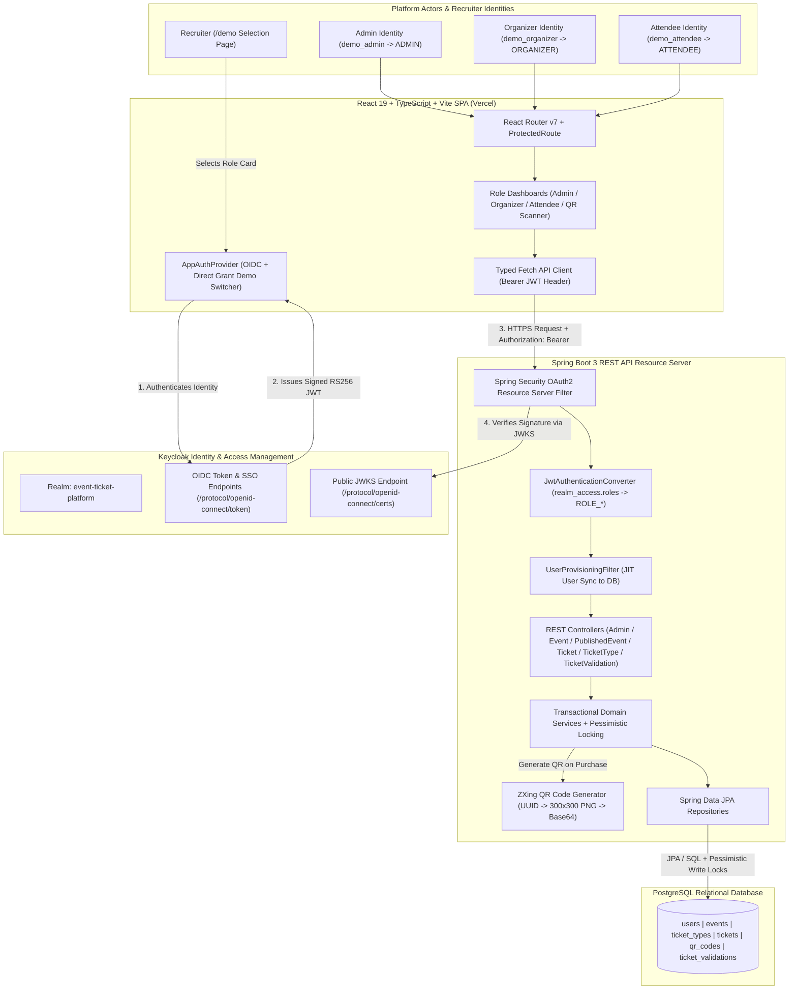
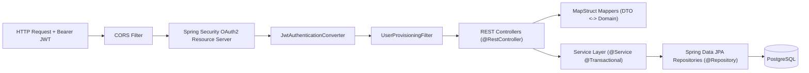
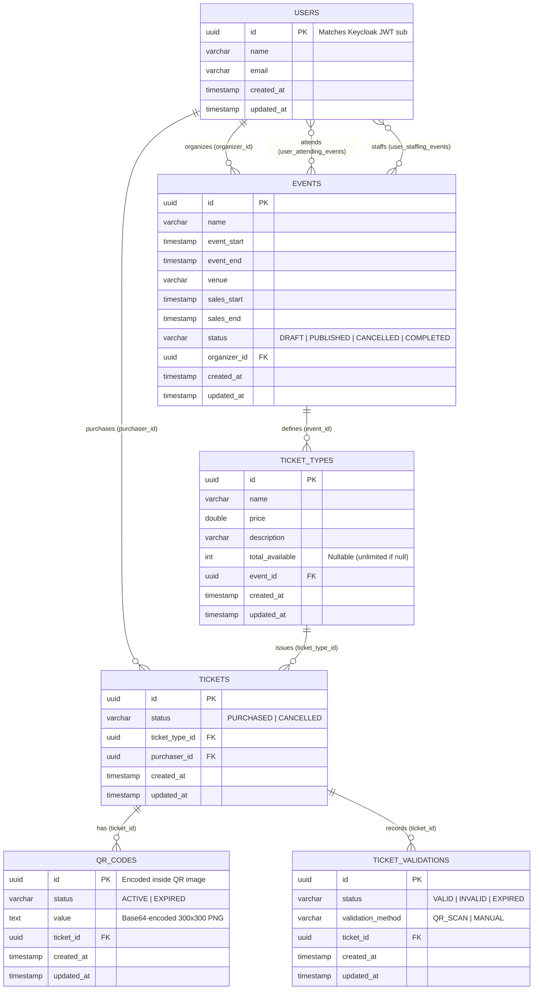
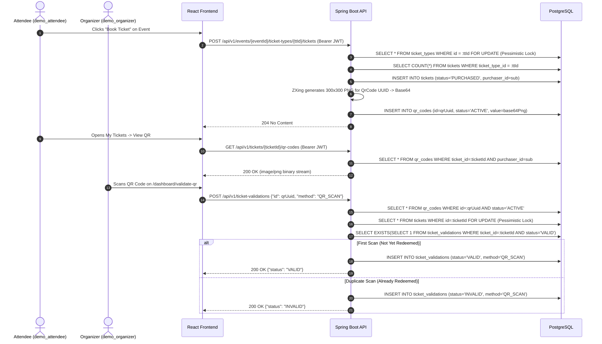

# Event Ticket Management Platform — System Architecture

## 1. Overall Architecture

The **Event Ticket Management Platform** is a full-stack, role-based event management and digital ticketing system built on a decoupled React SPA frontend, an OAuth2/OIDC identity provider (**Keycloak**), a stateless **Spring Boot 3** REST API resource server, and a relational **PostgreSQL** database.

Its two core architectural pillars are:
1. **Strict Role-Based Access Control (RBAC)** using OpenID Connect (OIDC) and cryptographically signed JSON Web Tokens (JWTs) issued by Keycloak across three independent roles (`ADMIN`, `ORGANIZER`, `ATTENDEE`) plus venue scanning (`STAFF`).
2. **Tamper-Resistant QR Ticket Issuance & Single-Use Validation** using Google ZXing and PostgreSQL pessimistic row-level locking (`SELECT ... FOR UPDATE`).

### High-Level Architecture Diagram

### Technology Responsibilities

| Technology | Primary Responsibilities |
|---|---|
| **React 19 + TypeScript + Vite** | Renders the dark-themed responsive UI, manages client-side routing (`react-router`), initiates OIDC / Recruiter Demo authentication, extracts JWT roles for UI navigation, displays dynamic QR codes, and streams camera input (`html5-qrcode`) for ticket scanning. |
| **Keycloak** | Acts as the centralized OpenID Connect (OIDC) Identity Provider (`event-ticket-platform` realm). Authenticates users (`demo_admin`, `demo_organizer`, `demo_attendee`, and standard users), manages sessions, and issues RS256-signed JWT access tokens containing `sub`, `preferred_username`, `email`, and `realm_access.roles`. |
| **Spring Boot 3** | Exposes versioned RESTful endpoints (`/api/v1/**`), orchestrates business logic, enforces transactional boundaries (`@Transactional`), maps entities to DTOs via MapStruct, and handles domain exceptions via `GlobalExceptionHandler`. |
| **Spring Security 6** | Configures the stateless OAuth2 Resource Server, validates JWT signatures and expiration against Keycloak's JWKS endpoint, converts Keycloak roles into Spring `GrantedAuthority` instances (`ROLE_ADMIN`, `ROLE_ORGANIZER`, `ROLE_ATTENDEE`, `ROLE_STAFF`), and enforces URL-level RBAC policies (`401 Unauthorized` / `403 Forbidden`). |
| **PostgreSQL** | Stores relational state across users, events, ticket types, purchased tickets, QR codes, and ticket validations. Guarantees ACID transactions and enforces pessimistic write locks (`LockModeType.PESSIMISTIC_WRITE`) to prevent ticket overselling and concurrent duplicate QR redemptions. |
| **Google ZXing** | Generates 300×300 pixel QR code bit matrices encoding the unique `QrCode` UUID upon ticket purchase and serializes them as Base64 PNG payloads. |
| **Vercel** | Hosts the React SPA frontend with global CDN caching, SPA fallback rewrites (`vercel.json`), and build-time environment variable injection. |

---

## 2. Frontend Architecture

The frontend is located in `frontend/` and is built with **React 19**, **TypeScript**, **Vite**, **Tailwind CSS**, **Radix UI / Shadcn primitives**, and **Lucide Icons**.

### Frontend Component & Routing Structure
- **Entry Point (`src/main.tsx`)**: Wraps the application in `AuthProvider` (`react-oidc-context`), `AppAuthProvider` (`src/context/demo-auth-context.tsx`), and `RouterProvider` (`react-router`).
- **Authentication Layer (`src/context/demo-auth-context.tsx`)**:
  - Bridges standard OIDC browser redirects (`react-oidc-context`) with direct Keycloak token exchanges for the three recruiter demo accounts (`demo_admin`, `demo_organizer`, `demo_attendee`).
  - Automatically falls back to Cryptographic Demo Mode (signed-structure JWTs with genuine role claims) only when the local/remote Keycloak server is unreachable, ensuring recruiters can always evaluate the live Vercel deployment.
  - Strictly enforces **single-identity sessions**: selecting a new demo role immediately clears any existing token (`sessionStorage`) before authenticating the requested identity.
- **Role Extraction Hook (`src/hooks/use-roles.ts`)**:
  - Decodes the active JWT access token payload (`jwt.split(".")[1]`), reads `realm_access.roles`, normalizes `ROLE_*` prefixes, and exposes `roles`, `hasRole(role)`, `isAdmin`, `isOrganizer`, `isAttendee`, `isStaff`, and `primaryRole`.
- **Route Guard (`src/components/protected-route.tsx`)**:
  - Checks `isAuthenticated`. If unauthenticated, redirects to `/login` preserving location state.
  - Checks `allowedRoles`. If the authenticated identity lacks the required role, renders an explicit **Access Restricted (`HTTP 403 — Insufficient Role Privileges`)** view showing the active identity (`activeIdentityUsername`), current role, and a button to switch identities on `/demo`.

### Frontend Route Map

| Route Path | Component | Allowed Roles | Description |
|---|---|---|---|
| `/` | `PublishedEventsPage` | Public | Landing page browsing published events with search and pagination, plus Recruiter Demo CTA banner. |
| `/demo` | `RecruiterDemoPage` | Public | Dedicated Recruiter Demo Selection Page with three role cards (`demo_admin`, `demo_organizer`, `demo_attendee`). |
| `/login` | `LoginPage` | Public | Redirects to Keycloak OIDC login or `/demo`. |
| `/callback` | `CallbackPage` | Public | Completes OIDC redirect login and routes to the role-appropriate dashboard. |
| `/events/:id` | `PublishedEventDetailsPage` | Public | Displays event details and ticket types; triggers ticket purchase (`ATTENDEE`). |
| `/events/:eventId/purchase/:ticketTypeId` | `PurchaseTicketPage` | `ATTENDEE`, `ADMIN` | Completes ticket booking for a selected ticket tier. |
| `/dashboard` | `DashboardPage` | Authenticated | Smart router redirecting `ADMIN` → `/dashboard/admin`, `ORGANIZER` → `/dashboard/events`, `STAFF` → `/dashboard/validate-qr`, `ATTENDEE` → `/dashboard/tickets`. |
| `/dashboard/admin` | `DashboardAdminPage` | `ADMIN` | Platform Administration Console displaying live KPIs, all events, and registered users with demo-data protection indicators. |
| `/dashboard/events` | `DashboardListEventsPage` | `ORGANIZER`, `ADMIN` | Lists events owned by the authenticated organizer with create/edit/delete controls. |
| `/dashboard/events/create` | `DashboardManageEventPage` | `ORGANIZER`, `ADMIN` | Form to create a new event and its ticket tiers. |
| `/dashboard/events/update/:id` | `DashboardManageEventPage` | `ORGANIZER`, `ADMIN` | Form to update an existing event and its ticket tiers. |
| `/dashboard/tickets` | `DashboardListTicketsPage` | `ATTENDEE`, `ADMIN` | Displays tickets purchased by the current attendee. |
| `/dashboard/tickets/:id` | `DashboardViewTicketPage` | `ATTENDEE`, `ADMIN` | Renders the digital ticket and fetches the scannable QR code PNG from `/api/v1/tickets/{id}/qr-codes`. |
| `/dashboard/validate-qr` | `DashboardValidateQrPage` | `ORGANIZER`, `STAFF`, `ADMIN` | Camera QR scanner and manual ticket ID validator calling `/api/v1/ticket-validations`. |

---

## 3. Backend Architecture

The backend (`backend/`) follows a clean layered architecture in package `com.eventhub.tickets`:

1. **Security & Filter Layer (`config/` & `filters/`)**:
   - `SecurityConfig`: Defines CORS policies, stateless session management, OAuth2 JWT resource server, and endpoint-level role authorization rules.
   - `JwtAuthenticationConverter`: Extracts `realm_access.roles` from the Keycloak JWT and maps both `ADMIN` and `ROLE_ADMIN` formats to canonical `SimpleGrantedAuthority("ROLE_ADMIN")` authorities.
   - `UserProvisioningFilter`: Runs after authentication and ensures a corresponding `User` row exists in the `users` table for the JWT `sub` UUID before hitting controllers (Just-In-Time provisioning).
2. **Controller Layer (`controllers/`)**:
   - `PublishedEventController` (`/api/v1/published-events`): Public browsing & search of `PUBLISHED` events.
   - `AdminController` (`/api/v1/admin`): Platform KPIs (`/overview`), user directory (`/users`), and global event oversight (`/events`). Restricted to `ROLE_ADMIN`.
   - `EventController` (`/api/v1/events`): CRUD operations for organizer events. Restricted to `ROLE_ORGANIZER` and `ROLE_ADMIN`.
   - `TicketTypeController` (`POST /api/v1/events/{eventId}/ticket-types/{ticketTypeId}/tickets`): Purchases a ticket for the authenticated attendee. Restricted to `ROLE_ATTENDEE`.
   - `TicketController` (`/api/v1/tickets`): Lists attendee tickets, retrieves ticket details, and streams `image/png` QR codes (`/api/v1/tickets/{ticketId}/qr-codes`). Restricted to `ROLE_ATTENDEE`.
   - `TicketValidationController` (`/api/v1/ticket-validations`): Validates tickets by QR code UUID (`QR_SCAN`) or Ticket UUID (`MANUAL`). Restricted to `ROLE_ORGANIZER`, `ROLE_STAFF`, and `ROLE_ADMIN`.
   - `GlobalExceptionHandler`: Maps domain exceptions (`EventNotFoundException`, `TicketsSoldOutException`, `QrCodeNotFoundException`, etc.) to structured `ErrorDto` responses with appropriate HTTP status codes.
3. **Service Layer (`services/impl/`)**:
   - `EventServiceImpl`: Enforces organizer ownership (`organizerId` matching JWT `sub`) on event queries, updates, and deletions.
   - `TicketTypeServiceImpl`: Acquires a `PESSIMISTIC_WRITE` lock on `TicketType`, verifies capacity (`purchasedTickets + 1 <= totalAvailable`), creates a `Ticket`, and invokes `QrCodeService.generateQrCode(ticket)`.
   - `QrCodeServiceImpl`: Generates a random `UUID`, encodes it into a 300×300 PNG via ZXing `QRCodeWriter`, Base64-encodes the image bytes, and persists the `QrCode` entity (`ACTIVE`).
   - `TicketValidationServiceImpl`: Looks up the `ACTIVE` `QrCode`, acquires a `PESSIMISTIC_WRITE` lock on the associated `Ticket`, checks if any `VALID` `TicketValidation` already exists, and records a new `TicketValidation` with status `VALID` (first scan) or `INVALID` (duplicate scan).

---

## 4. Database Architecture

The relational schema is managed via JPA/Hibernate entities in `com.eventhub.tickets.domain.entities`:

---

## 5. Authentication & Authorization Architecture

1. **Authentication (Keycloak OIDC)**:
   - Users authenticate against the `event-ticket-platform` realm using either Authorization Code + PKCE (`/login`) or the Recruiter Demo Role Switcher (`/demo`).
   - Three dedicated demo identities exist in Keycloak (`backend/keycloak/event-ticket-platform-realm.json`):
     - `demo_admin` → `ADMIN`
     - `demo_organizer` → `ORGANIZER`
     - `demo_attendee` → `ATTENDEE`
2. **Authorization (Spring Security + JWT)**:
   - Every protected API request includes `Authorization: Bearer <access_token>`.
   - `JwtAuthenticationConverter` extracts `realm_access.roles` and normalizes role strings into `ROLE_ADMIN`, `ROLE_ORGANIZER`, `ROLE_ATTENDEE`, and `ROLE_STAFF`.
   - `SecurityConfig` enforces strict path-based rules before controller invocation, returning `401 Unauthorized` for missing/invalid tokens and `403 Forbidden` when a valid token lacks the required role.

---

## 6. Ticket Booking, QR Generation & QR Validation Architecture

---

## 7. Deployment Architecture

- **Frontend (Vercel)**:
  - Deployed from the `frontend/` directory (`https://event-ticket-platform-frontend.vercel.app/`).
  - Configured via `frontend/vercel.json` (SPA rewrite `/(.*) -> /index.html`) and `frontend/.npmrc` (`legacy-peer-deps=true` for React 19 compatibility).
- **Backend & Keycloak (Docker / Cloud Hosting)**:
  - `backend/docker-compose.yml` provisions PostgreSQL (`db:5432`), pgAdmin (`8888`), and Keycloak (`keycloak:9090`) with automatic realm import (`--import-realm` mounting `./keycloak:/opt/keycloak/data/import`).
  - Spring Boot runs on port `8080` and validates tokens against `spring.security.oauth2.resourceserver.jwt.issuer-uri`.
