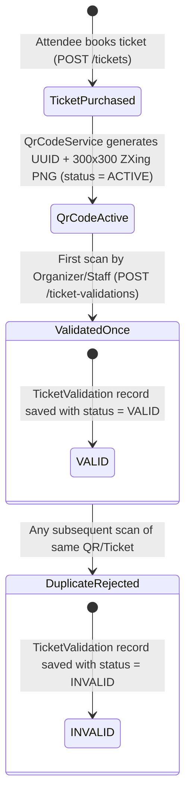

# QR Ticket Generation & Single-Use Validation Workflow

This document details the technical design, security controls, and concurrency guarantees of the QR code ticketing lifecycle in the **Event Ticket Management Platform**.

---

## 1. End-to-End QR Lifecycle

---

## 2. QR Code Generation (`QrCodeServiceImpl.java`)

When an attendee books a ticket via `POST /api/v1/events/{eventId}/ticket-types/{ticketTypeId}/tickets`:

1. **Pessimistic Capacity Check**:
   - `TicketTypeServiceImpl.purchaseTicket()` locks the `TicketType` row using `ticketTypeRepository.findByIdWithLock(ticketTypeId)` (`@Lock(LockModeType.PESSIMISTIC_WRITE)`).
   - Counts existing tickets (`ticketRepository.countByTicketTypeId(ticketTypeId)`) and verifies `purchasedTickets + 1 <= totalAvailable`.
2. **Opaque UUID Payload (Privacy by Design)**:
   - `QrCodeServiceImpl.generateQrCode(Ticket ticket)` generates a fresh `UUID.randomUUID()` as the QR code's primary key (`qrCode.id`).
   - Only this UUID string is encoded into the QR matrix via `com.google.zxing.qrcode.QRCodeWriter` (`BarcodeFormat.QR_CODE`, 300×300 pixels).
   - **No personally identifiable information (PII)** (such as attendee name, email, or Keycloak ID) is stored inside the QR code image.
3. **Persistence**:
   - The 300×300 PNG image is written via `MatrixToImageWriter.writeToStream(bitMatrix, "PNG", baos)`, Base64-encoded, and saved in `qr_codes.value` with `status = ACTIVE`.

---

## 3. QR Code Retrieval (`TicketController.java`)

- When an attendee opens `/dashboard/tickets/:id`, the React frontend calls `GET /api/v1/tickets/{ticketId}/qr-codes` with the attendee's Bearer JWT.
- `QrCodeServiceImpl.getQrCodeImageForUserAndTicket(UUID userId, UUID ticketId)` queries `qrCodeRepository.findByTicketIdAndTicketPurchaserId(ticketId, userId)`.
- Because the query joins `ticket.purchaser.id = :userId` (extracted directly from the verified JWT `sub` claim), **an attendee can never download another user's QR code**.

---

## 4. QR Code Validation & Single-Use Redemption (`TicketValidationServiceImpl.java`)

When an `ORGANIZER`, `STAFF`, or `ADMIN` scans a ticket at `/dashboard/validate-qr`:

1. **Endpoint Authorization**:
   - `POST /api/v1/ticket-validations` requires `hasAnyRole("ORGANIZER", "STAFF", "ADMIN")`.
   - Requests from `ATTENDEE` or unauthenticated callers are blocked by Spring Security (`403 Forbidden` / `401 Unauthorized`).
2. **Active QR Lookup**:
   - `qrCodeRepository.findByIdAndStatus(qrCodeId, QrCodeStatusEnum.ACTIVE)` verifies the scanned UUID corresponds to a genuine, active QR code issued by the platform. Forged or unknown UUIDs throw `QrCodeNotFoundException` (`400 Bad Request`).
3. **Row-Level Pessimistic Locking (Anti-Race Condition)**:
   - `ticketRepository.findByIdWithLock(qrCode.getTicket().getId())` acquires a `PESSIMISTIC_WRITE` (`SELECT ... FOR UPDATE`) lock on the `Ticket` row before checking validation history.
4. **Single-Use Redemption Check**:
   - `ticketValidationRepository.existsByTicketIdAndStatus(ticket.getId(), TicketValidationStatusEnum.VALID)` checks whether the ticket has already been redeemed.
   - **First scan**: Saves a `TicketValidation` record with `status = VALID` and returns `200 OK` with `{"status": "VALID"}`.
   - **Second or subsequent scan**: Saves a `TicketValidation` audit record with `status = INVALID` and returns `200 OK` with `{"status": "INVALID"}`.
